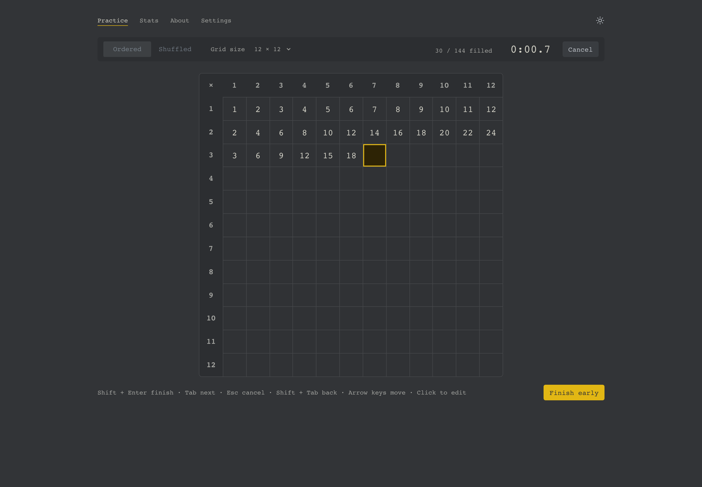

# Times tables

Keyboard-first multiplication practice with preset grids or custom factors, ordered or shuffled rounds, and scores saved in your browser.

[Play](https://times-tables.lynas.dev)

Styling inspired by [Monkeytype](https://monkeytype.com/).
